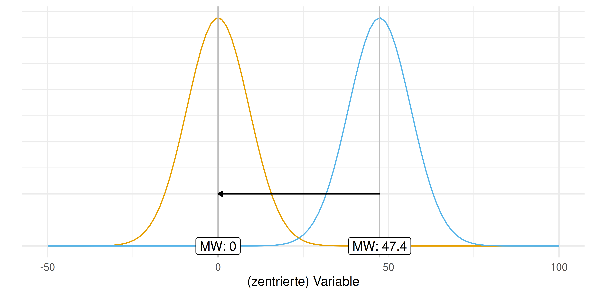
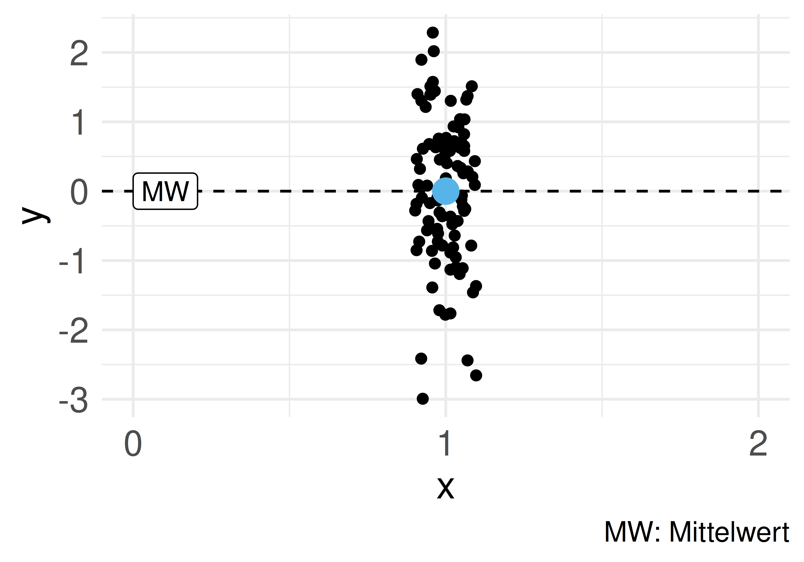
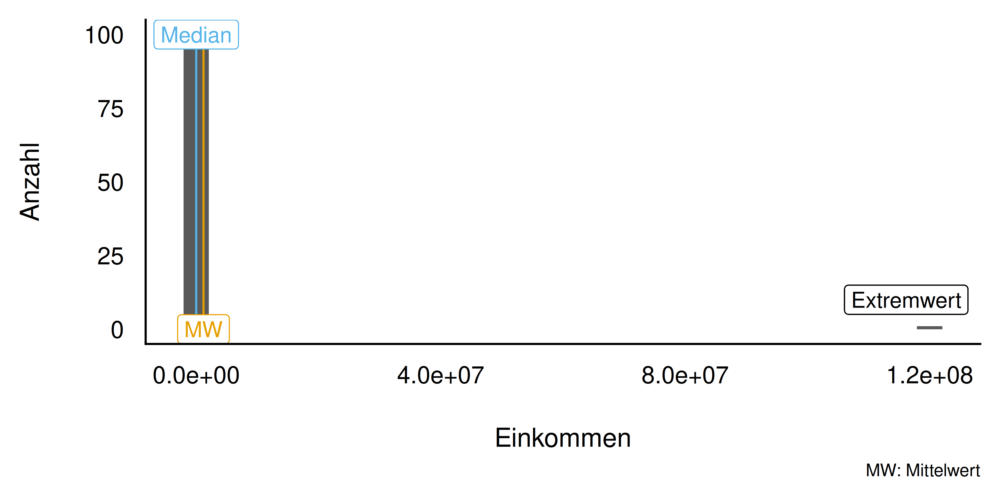

Question
========
Welches Bild zeigt Bestimmungsstücke der Definition von Statistik?


```{r echo=FALSE}
imgs <- 
  c("fig-norm-dev-1.png",
    "fig-zsmnfassen-1.png",
    "Bausteine_dplyr_crop.png",
    "fig-mbappe-1.png")
```


```{r, echo = FALSE, results = "hide"}
exams::include_supplement(imgs, recursive = TRUE)
```


Answerlist
----------

* {width=25%}
* {width=25%}
* {width=25%}
* {width=25%}


Solution
========

Die Definition von Statistik nennt drei Bestimmungsstücke: zur zentralen Tendenz zusammenfassen, Unterschiedlichkeit quantifizieren und Ungewissheit beschreiben.

Richtig ist das Bild mit der Punktwolke und dem eingezeichneten Mittelwert (MW): Es zeigt das Zusammenfassen, viele Datenpunkte werden zu einem einzigen Wert zusammengefasst.

Die anderen Bilder zeigen kein Bestimmungsstück der Definition:

* Die zwei Glockenkurven mit Pfeil zeigen das Zentrieren einer Variablen (Verschieben um ihren Mittelwert), also eine Transformation.
* Die graue Figur, die daneben in farbige Einzelteile zerlegt ist, zeigt das Baukastenprinzip von `dplyr` (komplexe Aufgaben aus einfachen Bausteinen), also Datenaufbereitung.
* Das Histogramm mit Extremwert zeigt, wie ein einzelner Extremwert den Mittelwert verzerrt (Robustheit von Kennwerten).


Aufgabenname: `aufgaben_statistik`


Answerlist
----------
* Falsch
* Richtig
* Falsch
* Falsch


Meta-information
================
exname: aufgaben_statistik
extype: schoice
expoints: 1
exsolution: 0100
exshuffle: true

